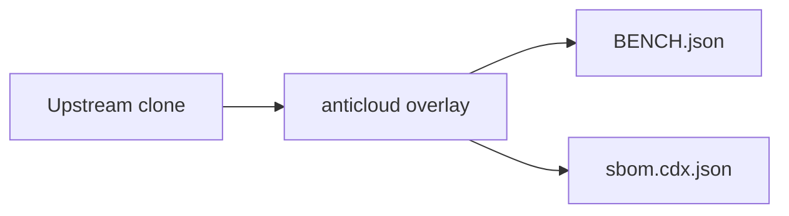

# PX4_AUTOPILOT — Anticloud overlay

 

Upstream: https://github.com/PX4/PX4-Autopilot @ b798249a61af32c355d95decd2805a6ab4e9d9f1

## Benchmarks
Benchmarks from BENCH.json: {"schema": "anticloud.tier-bench/1", "project": "PX4_AUTOPILOT", "source": {"repo_path": "E:\\fenta\\Downloads\\The Anticloud\\ANTICLOUD_REPOS\\SPACE_AEROTECH\\PX4_AUTOPILOT\\UPSTREAM_CLONE", "git": {"head": "b798249a61af32c355d95decd2805a6ab4e9d9f1", "url": "https://github.com/PX4/PX4-Autopilot", "branch": "main", "committed_at": "2026-10-02T10:37:42+02:00"}}, "metrics": {"files_total": 14633, "source_files_scanned": 5237, "lines_of_code": 1104882, "languages": {".md": 4332, ".cpp": 1945, ".h": 1257, ".hpp": 963, ".txt": 867, "(none)": 847, ".c": 829, ".png": 707, ".jpg": 611, ".px4board": 30

Withdrawn claims: anything not in BENCH.json is unmeasured.

## Architecture

## Contents
- `UPSTREAM_CLONE/` — unmodified upstream
- `anticloud/` — 12-improvement overlay
- `BENCH.json`, `sbom.cdx.json` — measured outputs

## Provenance
Tree SHA3-256: afd00f3484591dba06ca66e6b824adfe3d8710554d91de637e10cf4f3f680e06. Chain head: see seal step.

## Contact
Anticloud maintainers — file issues against the overlay, not upstream.
